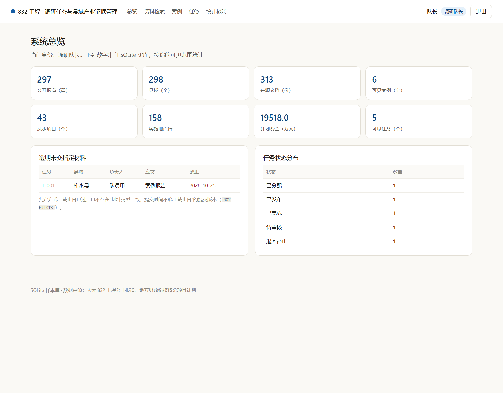

# 832 工程调研任务与县域产业证据管理系统

一个把「散在网页里的公开报道」变成「可追溯、可审核、可发布」产业案例的小型数据库应用。

《数据库系统概论》课程大作业 · 参考选题 1。实现方式为**选项 1：传统动态网站**（Flask + SQLite + Jinja 服务端渲染），
SQL 全部手写并在服务端执行，不用 ORM 隐藏。



**它解决的问题**：一篇报道一个网页，截图存在微信里、链接存在文档里；三个月后要复核一句"合作社统一供苗"，
翻不回原文。"计划资金"被写成"已支付"、"计划接待量"写成"实际接待量"，数字没错、含义错了。
谁改的、谁审的、改到第几版，全靠群里翻聊天记录。

**这个库的做法**：建 22 张表，让每一句对外说法都能退回它所在的原文段落（`case_evidence` → `source_excerpt`），
让每一次提交都是一个不可覆盖的新版本（`deliverable_version`），让每一次状态变更都留一条审计日志（`audit_log`）。

---

## 一、快速开始

### 1.1 环境要求

| 项 | 要求 | 说明 |
|---|---|---|
| Python | **3.9 及以上**（开发环境 3.13） | Flask 3.x 的最低要求 |
| 第三方依赖 | **只有 Flask** | `pip install flask` 即可，无数据库服务、无前端构建 |
| 数据库 | 无需安装 | SQLite 是 Python 标准库自带，样本库文件随仓库提供 |
| 网络 | 运行时不联网 | 页面数据全部来自本地 `.sqlite` |

### 1.2 三步跑起来

```bash
# 1) 装依赖（用 python -m pip，避免 pip 指向另一个解释器）
python -m pip install flask

# 2) 启动（默认 5000 端口）
python app.py

# 3) 浏览器打开
#    http://127.0.0.1:5000
```

看到 `Running on http://127.0.0.1:5000` 就成了。

> **不需要**先建库或跑迁移脚本。`832_research_sample.sqlite` 已经包含 22 张表、3 个视图、
> 297 篇真实报道和 6 个演示账号，克隆下来就能登录。
> 只有在你自己改过表结构时，才需要跑 `python migrate_v4.py`（幂等，可重复执行）。

macOS / Linux 上如果 `python` 命令不存在，把上面的 `python` 换成 `python3`。

### 1.3 验证是否正常

```bash
python test_backend.py
```

期望输出最后一行：

```
结果：29/29 通过
```

脚本会自己在 `tmp/` 下建一份数据库副本再跑，**不会改动你的样本库**。

### 1.4 常见问题

| 现象 | 原因与处理 |
|---|---|
| `ModuleNotFoundError: No module named 'flask'` | 依赖装到了另一个解释器。改用 `python -m pip install flask`，确认 `python -c "import flask"` 不报错 |
| `OSError: [WinError 10048] 端口已被占用` | 5000 被占。换端口：见下方 1.5 |
| 浏览器打不开、显示拒绝连接 | 服务没启动成功，回去看终端里有没有报错；或地址写成了 `https://`（应为 `http://`） |
| 登录提示"账号或口令不正确" | 口令统一为 `832demo`，大小写敏感；账号要输中文名（如 `队员甲`），不是 `member` |
| 页面样式全丢 | 确认是用 `python app.py` 启动的（不是直接双击 `templates/*.html`） |
| 中文文件名报错 | 仓库内 `832_阶段汇报/` 是中文目录，只影响 PPT 资源，不影响程序运行 |

### 1.5 换端口 / 开调试

`app.py` 读两个环境变量，不同终端写法不同：

```bash
# macOS / Linux / Git Bash
PORT=5001 python app.py
APP_DEBUG=1 python app.py          # 开调试模式（改代码自动重载）

# Windows CMD
set PORT=5001 && python app.py

# Windows PowerShell
$env:PORT="5001"; python app.py
```

---

## 二、怎么用

### 2.1 先不登录，看"公众视角"

直接打开 <http://127.0.0.1:5000/cases>：**只显示 5 条"已发布"案例**，没有任何按钮。
这就是这个库对外的样子——`/` 总览、`/reports` 检索、`/stats` 统计、`/cases` 案例，四个页面未登录都能看。

### 2.2 按角色走一遍（约 5 分钟，能看清全部功能）

演示口令**统一为 `832demo`**，登录页把 6 个账号都列出来了，点名字再输口令即可。

| 账号 | 角色 | 能做什么 | 不该看到什么 |
|---|---|---|---|
| 管理员 | admin | 全部操作 | — |
| 队长 | leader | 建任务、指派、**发布**成果 | — |
| 队员甲 / 队员乙 | member | 看被指派的任务；自己创建的案例可改可删（仅草稿） | 别人的草稿与退回稿（打开返回 404） |
| 审核员 | reviewer | 通过 / 退回 | 不能发布；不能审自己提交的版本 |
| 研究员 | researcher | 全库检索，只读 | 不能改任何东西 |

推荐路线（顺着点就能看到"证据台账"是怎么运转的）：

1. **登录 `队员甲`** → 首页看「我负责的任务」和「逾期未交指定材料」
2. 进 `/cases` → 点「新建案例草稿」→ 填县域、产业、标题、说法摘要，**必须勾至少一条出处摘录** → 保存
3. 打开刚建的草稿 → 点「提交审核」→ 状态变 `待审核`，同时「修改 / 删除」按钮消失
4. **退出，登录 `审核员`** → 打开这条案例 → 点「退回」但**不写理由** → 会被拦下提示"退回必须写明理由"
5. 补上理由退回 → 状态变 `退回补正`；换回 `队员甲` 可以继续改、再提交
6. `审核员` 点「通过」→ 状态 `已审核`
7. **`队长`** 登录 → 打开这条 → 出现「发布」按钮 → 点它 → 状态 `已发布`
8. **退出登录**，再打开 `/cases` —— 这条现在公众可见了，而且点进去没有任何操作按钮

案例详情页底部的「操作记录」，就是 `audit_log` 的投影：谁、什么时间、做了什么，连退回理由一起留。

### 2.3 想看任务与版本流转

登录 `队员甲` → `/tasks` → 打开 `T-003`（状态 `退回补正`，已交过 1 版）→ 提交一份材料，
会生成**第 2 版**（旧版不覆盖）→ `审核员` 退回 → 再提交变第 3 版 → `审核员` 通过 → `队长` 发布。

任务详情页能看到分派情况、全部历史版本和审核记录，版本号逐次递增、旧版永不覆盖。

### 2.4 想随便折腾，用测试库

样本库只有 6 条案例，不适合反复试。生成一份带全套测试数据的副本：

```bash
python make_test_data.py            # 首次生成 832_test_playground.sqlite
DB_PATH=832_test_playground.sqlite PORT=5000 python app.py
```

这份测试库有 12 个任务、13 个案例，覆盖**全部 5 种案例状态和 6 种任务状态**，还刻意留了 3 条逾期任务。

- 玩坏了重来：`python make_test_data.py --force`
- 回到正式数据：去掉 `DB_PATH=...` 直接 `python app.py`
- 把样本库改乱了：`git checkout 832_research_sample.sqlite` 即可还原

### 2.5 页面地图

| 地址 | 看什么 | 谁能访问 |
|---|---|---|
| `/` | 总览：报道/县域/案例/资金统计，逾期任务清单，任务状态分布 | 所有人 |
| `/login` | 登录（列出全部演示账号） | 所有人 |
| `/reports` | 公开资料检索：按关键词、省份、县域查 297 篇报道，看哪些还没整理成案例 | 所有人 |
| `/cases` | 案例列表：按县域、产业、帮扶方式、状态组合检索 | 按角色收窄 |
| `/cases/new` | 新建案例草稿 | 除研究员外 |
| `/cases/<id>` | 案例详情：说法、帮扶方式、出处摘录、操作记录 | 按角色收窄 |
| `/tasks` | 任务列表：状态、负责人、截止日、逾期标记 | 仅登录用户 |
| `/tasks/new` | 新建并指派任务 | 队长、管理员 |
| `/stats` | 统计核验：5 组指标，每块一条真实 SQL | 所有人 |

更细的手测清单见 [`docs/测试指南.md`](docs/测试指南.md)。

---

## 三、目录

| 文件 | 作用 |
|---|---|
| `app.py` | 全部路由、会话登录、角色装饰器、事务边界 |
| `db.py` | 连接管理、查询助手、`transaction()` 上下文 |
| `832_schema.sql` | 完整 DDL（22 表 + 3 视图 + 9 索引 + 1 触发器） |
| `832_research_sample.sqlite` | 样本库（真实数据 + 课程模拟数据，用 `data_kind` 区分） |
| `templates/` `static/` | 服务端渲染模板与样式 |
| `test_backend.py` | 端到端测试（29 项断言） |
| `make_test_data.py` | 生成可随意折腾的测试库（不影响样本库） |
| `docs/测试指南.md` | 手测清单：账号、五条测试路线、边界说明 |
| `capture_screens.py` | 截图脚本 |
| `docs/er/` | E-R 图（4 张，16:9，SVG + 2× PNG + 预览页） |
| `docs/范式分析.md` | 22 张表的范式判定与反规范化说明 |
| `832_阶段汇报/` | 汇报 PPT（18 页）及其设计源文件、E-R 与截图素材 |

## 四、功能拆解与实现位置

| 需求 | 功能 | 路由 | 函数（app.py） | 关键 SQL / 数据库对象 | 截图 |
|---|---|---|---|---|---|
| 用户与权限 | 口令登录、角色识别 | `POST /login` | `login()` | 查 `user_account`，`check_password_hash` 比对 | 01 |
| 用户与权限 | 可见范围收窄 | 各列表页 | `case_scope()` `task_scope()` | 条件拼进 `WHERE`：`status='已发布' OR owner_id=?` / `task_id IN (SELECT … task_assignment)` | 02 |
| 检索与阅读 | 按县、省、关键词查报道 | `GET /reports` | `reports()` | 三表 JOIN + 关联案例计数子查询 + `LIMIT 200` | 03 |
| 检索与阅读 | 案例组合检索 | `GET /cases` | `cases()` | `WHERE` 动态叠加；帮扶方式用 `EXISTS(… case_mechanism … mechanism)`；列表用 `group_concat` 聚合 | 04 |
| 数据管理 | 新建 / 修改案例草稿 | `GET/POST /cases/new`、`/cases/<id>/edit` | `_save_case()` | `INSERT industry_case` + 桥表 `case_mechanism`、`case_evidence`；修改时先 `DELETE` 桥表再插 | — |
| 数据管理 | 删除草稿 | `POST /cases/<id>/delete` | `case_delete()` | 事务内先删桥表再删主表；仅 `status='草稿'` 且本人 | — |
| 业务流程 | 案例提交审核 | `POST /cases/<id>/submit` | `case_submit()` | 先查 `case_evidence` 是否有出处，无出处拒绝提交；`UPDATE … SET status='待审核'` + 写 `audit_log` | 05 |
| 业务流程 | 案例审核 / 发布 | `POST /cases/<id>/review`、`/publish` | `case_review()` `case_publish()` | `UPDATE` 状态；退回理由为空则拒绝（对应 `review_action` 的 `CHECK`） | 05 |
| 业务流程 | 任务列表与逾期判定 | `GET /tasks` | `tasks()` | 视图 `v_task_progress`；逾期用 `NOT EXISTS` 子查询 | 06 |
| 业务流程 | 新建并指派任务 | `GET/POST /tasks/new` | `task_new()` | 一个事务写 `field_task` + `task_assignment` + `audit_log` | — |
| 业务流程 | 提交材料版本 | `POST /tasks/<id>/submit` | `task_submit()` | 事务：`INSERT source_document`（材料建档）→ `INSERT deliverable_version`（版本号 = max+1）→ `UPDATE field_task.state` → `INSERT audit_log` | 08 |
| 业务流程 | 审核版本 | `POST /tasks/<id>/review` | `task_review()` | 事务：`INSERT review_action` + `UPDATE field_task.state` + 日志；触发器 `prevent_self_review` 兜底 | 06 |
| 业务流程 | 发布成果 | `POST /tasks/<id>/publish` | `task_publish()` | 事务：任务置“已发布”，并同步关联案例状态 | 06 |
| 统计与分析 | 分组、聚合、勾稽 | `GET /stats` | `stats()` | `GROUP BY` 各省篇数；`HAVING COUNT(DISTINCT)=2` 查双方式案例；`SUM` 汇总计划资金；`HAVING ABS(差额)>ε` 核对 158 行 | 07 |

## 五、数据库对象

- **22 张表**：18 张实体表 + 4 张多对多桥表（`case_mechanism`、`case_evidence`、`task_assignment`、`evidence_issue_source`）
- **3 个视图**：`v_published_case`、`v_task_progress`、`v_project_category`
- **9 个索引**：含部分唯一索引 `idx_one_task_lead`（一任务一负责人）、唯一索引 `idx_mention_unique`（同一报道同一人物只记一次）
- **完整性约束**：主键、外键（`PRAGMA foreign_keys=ON`）、`UNIQUE`（来源网址、一任务一材料类型）、`CHECK`（状态枚举、金额非负、退回必填理由）、触发器 `prevent_self_review`
- **事务**：提交、审核、发布三类写操作各自 `BEGIN … COMMIT`，异常整体回滚
- **范式处理**：`public_report` 不存标题（取自 `source_document`），消除冗余；详见 `docs/范式分析.md`

## 六、已知边界（报告里要如实写）

1. **正文未入库**：297 篇报道只存标题、URL、县、省、日期，因此检索是「标题 + 县名 + 省份」的组合匹配，不是全文检索。补全文需要抓取正文并接中文分词（如 jieba 预分词 + FTS5），属于扩展项。
2. **未实现选项 2（Text2SQL）**：本项目走选项 1，SQL 全部手写并在服务端执行。
3. **角色权限在应用层 + SQL 层实现**：SQLite 不支持 `GRANT`，所以“谁能看哪些行”由 `WHERE` 条件与路由装饰器共同保证，报告中需说明这一点。
4. **数据性质**：报道、政府项目为真实数据；账号、任务、审核记录为课程模拟数据，库内用 `data_kind` 字段强制区分。
5. **金额口径**：所有项目金额均为“2024 年度计划安排资金”，不是实际支出，也不是农户收入。

## 七、E-R 图（`docs/er/`）

教材式画法：矩形 = 实体（框内列属性，主键加下划线），菱形 = 联系，椭圆 = 联系的属性，连线旁标 1 / n / m。

| 文件 | 内容 | 用途 |
|---|---|---|
| `00_总览.svg/png` | 三域 + 实体清单 + 4 张 m:n 桥表 | PPT 第 2 页讲整体结构 |
| `01_资料与案例域.svg/png` | 来源→报道→摘录→案例→帮扶方式 | 讲证据链 |
| `02_任务与审核域.svg/png` | 队伍/账号/任务/版本/审核，含带属性的 m:n | 讲流程与事务 |
| `03_政府项目与核验域.svg/png` | 项目/快照/实施地点/核对记录 | 讲金额勾稽 |
| `index.html` | 四张图预览，A4 横向分页 | 浏览器打开后 Ctrl+P 存 PDF |

- **放 PPT**：插入 `.png`（2 倍图，1280×720 对应 16:9 版式）或直接插入 `.svg`（可无损缩放、可改文字）。
- **重新生成**：`python docs/er/build_er.py`（改坐标或文案后重跑即可，无需手动改 SVG）。

## 八、数据来源与合规声明

- **报道数据（297 篇）**：来自中国人民大学应用经济学院公开发布的 832 个脱贫县追踪报道，
  仅保存**标题、原文链接、所属县、省份、发布日期**五个字段，发布日期范围 2023-07 至 2026-03。
  **未抓取或存储报道正文全文**，因此本库不构成对原文的替代，复核时需点开原文链接。
- **政府项目数据**：来自涞水县、柞水县、霍邱县等县级政府网站公开的年度实施计划、项目储备库与资金批复。
- **课程模拟数据**：账号、任务、审核记录、以及标注为「课程模拟」的案例，为演示流程而构造，
  库内用 `data_kind` 字段与真实数据强制区分，可一条 SQL 筛出：

  ```sql
  SELECT data_kind, COUNT(*) FROM industry_case GROUP BY data_kind;
  -- 公开报道整理 | 5
  -- 课程模拟     | 1
  ```

- **口径纪律**：所有项目金额均为「2024 年度计划安排资金」，**不是实际支出，也不是农户收入**；
  「金额核对 0 处不一致」只表示本次核对通过，不代表项目效果已被验证。
- 若权利人认为某条数据不宜公开，提 issue 后会移除。

## 九、安全说明

这是一个**课程演示项目，未经安全加固，请勿直接部署到公网**：

- 演示口令统一为 `832demo`，源码与数据库中都可见；`password_hash` 为真实的 scrypt 哈希，不是明文。
- `app.secret_key` 在未设置 `SECRET_KEY` 环境变量时使用一个固定默认值，仅够本地演示；
  线上部署必须通过环境变量注入随机值。
- 表单未加 CSRF token，`debug` 默认关闭（`APP_DEBUG=1` 才开启）。

## 十、许可

代码以 MIT 协议开源，可自由参考。**库内的报道与政府文件数据版权归原发布方**，
本仓库仅保存标题与链接用于学术整理，转载数据请遵循原发布方要求。
